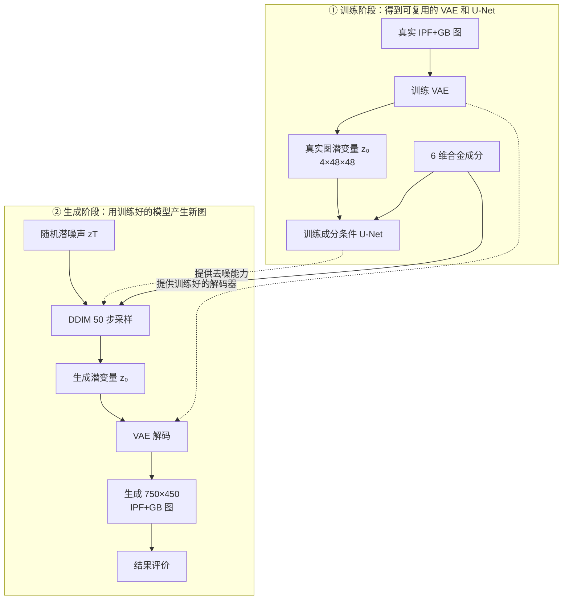

# 主流程图与关键参数说明

状态：供用户审核。尚未运行正式训练或生成。

## 1. 精简主流程图



图中上半部分是训练，下半部分是生成。生成阶段不是另一套独立模型：DDIM 调用上面训练好的 U-Net，把随机噪声 `zT` 逐步变成生成潜变量 `z0`；随后调用上面训练好的 VAE 解码器，把 `z0` 还原成 RGB IPF+GB 图。两条虚线只表示“复用训练结果”，不表示额外的数据处理流程。

统一热处理和运行时间不再放进主流程框图：热处理是 22 个样本共同的固定实验背景，不进入 MLP；计时器是程序运行监控，不参与模型计算。详细参数仍保留在后续章节。

图的布局参考潜空间扩散模型常见画法：区分训练与采样，条件分支进入去噪模型，并明确编码器/解码器的复用关系。主要依据是 Rombach 等人的 LDM Figure 3；该论文 Figure 1 和 Figure 6 还强调了空间压缩倍数与重建质量、训练效率之间的折中。

## 2. 低维潜变量 z 的维度

“维度”需要同时说明通道和空间尺寸，不能只说 4 维。

| 使用位置 | RGB 图像张量 | 潜变量 z | 展平标量数 | 相对 RGB 标量数 |
|---|---:|---:|---:|---:|
| 训练 patch | `B×3×192×192` | `B×4×48×48` | 每张 9,216 | 约为原图的 1/12 |
| 整图生成画布 | `B×3×512×768` | `B×4×128×192` | 每张 98,304 | 约为画布的 1/12 |

形成依据：

- `latent_channels=4`，所以潜变量有 4 个通道。
- VAE 有 3 级通道块 `[64, 128, 256]`；Diffusers 的实际空间缩小倍数为 `2^(3-1)=4`。
- 因此训练 patch 的空间尺寸由 `192×192` 变为 `48×48`。
- 生成时先用可被网络整除的 `768×512` 画布，所以潜变量空间为 `192×128`，最后在 RGB 空间中心裁剪成 `750×450`。

当前选择不是凭感觉固定。正式接受它之前，应比较：

1. 潜通道数 2、4、8；
2. 空间下采样倍数 4 与 8；
3. VAE 重建的 RGB L1、Sobel 晶界误差、晶界面积分数和连通区域统计；
4. 显存、单步耗时和扩散训练稳定性。

本项目优先采用 `4×48×48`，因为 EBSD 图中的细晶界比普通自然图像更怕过度压缩，而 RTX 5060 Ti 8 GB 又要求控制显存。正式扩散训练前必须先验收 VAE 重建，若晶界明显断裂或变糊，就不能进入下一阶段。

## 3. 热处理条件

1–22 号统一采用：

```text
固溶：980 ℃，保温 1 h，空冷
时效一：730 ℃ × 8 h
转换：以 55 ℃/h 炉冷至 620 ℃
时效二：620 ℃ × 8 h，随后空冷
```

它已保存到：

- `data/heat_treatment.csv`：22 行结构化记录；
- `data/热处理工艺说明.md`：中文解释；
- `data/热处理工艺原始截图.png`：用户提供的原始图片。

由于 22 个样本的热处理完全相同，其标准差为 0，当前无法学习“热处理变化 → 组织变化”。因此它作为固定实验背景参与数据一致性审计，但不进入成分条件 MLP。未来加入不同热处理制度的数据后，才能把温度、时间、冷却方式和速率作为条件变量。

## 4. 运行时间与剩余时间记录

每个长流程都记录以下字段：

- `flow_stage`：当前处于训练、保存检查点、DDIM 去噪、VAE 解码等哪个阶段；
- `completed_units / total_units`：已完成步数、图片数或留一折数；
- `elapsed`：累计已用时间；
- `estimated_remaining`：按当前平均速度估算的剩余时间；
- `estimated_finish_local`：本机时区的预计完成时刻；
- `average_seconds_per_unit`：平均每步、每图或每折耗时。

| 流程 | 实时状态 | 完整历史 | 最终汇总 |
|---|---|---|---|
| VAE 训练 | `08_训练与生成结果/01_VAE模型/run_progress.json` | 同目录的 `run_progress_history.jsonl` | `01_VAE模型/final/training_metadata.json` |
| 扩散训练 | `08_训练与生成结果/02_扩散模型/run_progress.json` | 同目录的 `run_progress_history.jsonl` | `02_扩散模型/final/run_metadata.json` |
| 单条件生成 | 对应输出目录的 `alloy_XX_progress.json` | `alloy_XX_progress_history.jsonl` | `alloy_XX_generation_report.json` |
| 22 种批量生成 | `08_训练与生成结果/04_22种合金正式生成图/all_alloys_progress.json` | 同目录的 `all_alloys_progress_history.jsonl` | `generation_summary.json` |
| LOO 验证 | `08_训练与生成结果/05_留一验证/loo_progress.json` | 同目录的 `loo_progress_history.jsonl` | `loo_summary.json` |

终端进度条同步显示 `stage / elapsed / remaining`。刚开始没有足够速度样本时，ETA 显示 `--:--:--`；完成若干步后才逐渐稳定。保存检查点、磁盘写入和系统负载会使 ETA 波动，因此它是动态估计，不是保证完成时间。

## 5. 最终生成多少张图

项目区分两种用途：

- 单次预览：`06_生成1号合金8张预览.py` 默认生成 8 张，只用于快速检查。
- 正式批量：`09_批量生成22种合金704张图.py` 默认每种合金生成 32 张。

因此正式已有成分生成总量为：

```text
22 种合金 × 32 张/合金 = 704 张 RGB IPF+GB 图
```

704 张是推荐的生成样本数，不等于新增 704 个真实实验样本。它用于观察同一成分下不同随机种子的多样性和计算生成分布统计。任何新成分、插值成分或 LOO 预测图另行计数，并必须单独标记。

## 6. 图示与设计依据

1. Rombach et al., *High-Resolution Image Synthesis with Latent Diffusion Models*, CVPR 2022. [arXiv:2112.10752](https://arxiv.org/abs/2112.10752), [DOI](https://doi.org/10.1109/CVPR52688.2022.01042).
2. Ho et al., *Denoising Diffusion Probabilistic Models*, 2020. [arXiv:2006.11239](https://arxiv.org/abs/2006.11239).
3. Song et al., *Denoising Diffusion Implicit Models*, ICLR 2021. [arXiv:2010.02502](https://arxiv.org/abs/2010.02502).
4. Ho and Salimans, *Classifier-Free Diffusion Guidance*, 2022. [arXiv:2207.12598](https://arxiv.org/abs/2207.12598).
